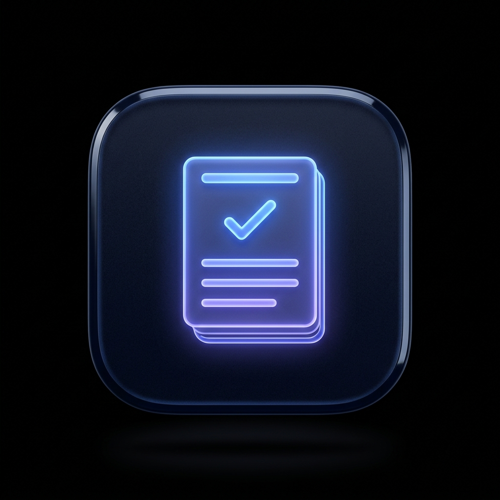
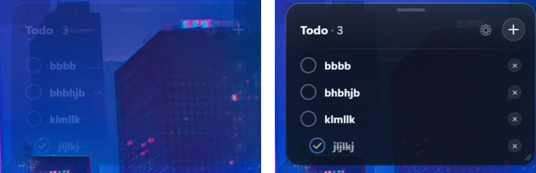
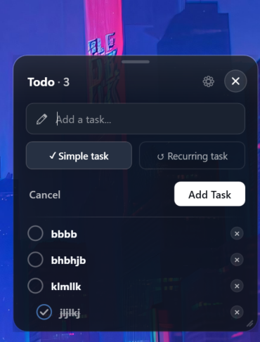
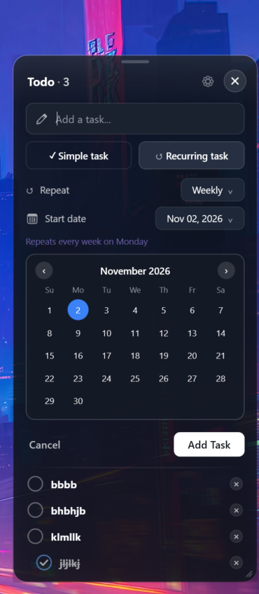
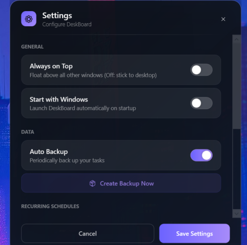

<p align="center">
  
</p>

<h1 align="center">DeskBoard</h1>

<p align="center">
  <b>A modern, translucent frosted-glass desktop task manager for Windows 10 and 11.</b><br>
  Lives directly on your desktop wallpaper with zero distraction, autonomous recurrence, and smooth spring physics.
</p>

<p align="center">
  
  
  
  
  
</p>

---

## 📸 Screenshots Showcase

<p align="center">
  
  <br>
  <sub><b>DeskBoard residing seamlessly on the Windows desktop wallpaper in harmony with your workspace</b></sub>
</p>

| Ambient Mode vs. Active Focus | Add Task (Inline Expander) |
| :---: | :---: |
| <br><sub><b>Left:</b> Ambient desktop watermark (18% opacity) &nbsp;|&nbsp; <b>Right:</b> Active interactive focus on hover</sub> | <br><sub>Quick inline task creator with Simple and Recurring mode pills</sub> |

| Custom Glass Calendar & Recurrence Engine | Settings & Automated Database Backup |
| :---: | :---: |
| <br><sub>Custom frosted-glass calendar picker with weekly, monthly & yearly schedules</sub> | <br><sub>Manage Always-on-Top, Start with Windows, and automated SQLite backups</sub> |

---

## 📥 Downloads & Installation Options

DeskBoard provides **4 flexible ways** to download, install, and run:

| Option | Download | File Size | Prerequisites | Best For |
| :--- | :---: | :---: | :---: | :--- |
| **1️⃣ Complete Windows Installer** *(One-Click Setup)* | [`DeskBoardSetup.exe`](https://github.com/vedavyas1235/Deskboard/releases/latest/download/DeskBoardSetup.exe) | **~50 MB** | **None** | Full setup wizard with embedded .NET 8 runtime. Works out-of-the-box on any Windows 10/11 PC |
| **2️⃣ Lightweight Windows Installer** *(Fast Install)* | [`DeskBoardSetup-Lightweight.exe`](https://github.com/vedavyas1235/Deskboard/releases/latest/download/DeskBoardSetup-Lightweight.exe) | **~4 MB** | [.NET 8 Desktop Runtime](https://dotnet.microsoft.com/download/dotnet/8.0/runtime) | One-click setup wizard for users who already have .NET 8 (adds Start menu, uninstaller) |
| **3️⃣ Standalone Portable** | [`DeskBoard-Standalone.zip`](https://github.com/vedavyas1235/Deskboard/releases/latest/download/DeskBoard-Standalone.zip) | **~65 MB** | **None** (Plug & Play) | No installation needed. Extract anywhere (Desktop, USB drive) and run |
| **4️⃣ Lightweight Portable** | [`DeskBoard-Lightweight.zip`](https://github.com/vedavyas1235/Deskboard/releases/latest/download/DeskBoard-Lightweight.zip) | **~1.5 MB** | [.NET 8 Desktop Runtime](https://dotnet.microsoft.com/download/dotnet/8.0/runtime) | Tiny 1.45 MB portable zip for developers & users with .NET 8 already installed |

---

### Which version should you choose?

* **Choose Option 1 (Complete Installer - ~50 MB)** if you want a classic setup wizard that works on **any Windows 10 or 11 computer** without asking you to install anything else.
* **Choose Option 2 (Lightweight Installer - ~4 MB)** if your computer already has .NET 8 (like your PC!) and you want a standard Windows installer that adds shortcuts and appears in Windows Settings / Add or Remove Programs.
* **Choose Option 3 (Standalone Portable - ~65 MB)** if you want a zero-install, single-folder app you can carry on a flash drive or drop onto your Desktop that runs on any PC without .NET installed.
* **Choose Option 4 (Lightweight Portable - ~1.5 MB)** if your PC has .NET 8 and you just want the absolute smallest download (~1.45 MB) to run directly without installing.

---

## ✨ Key Features

### 🪟 Frosted Glassmorphism & Desktop Integration
* **Wallpaper Docking**: By default, DeskBoard stays docked seamlessly to your Windows wallpaper (`Topmost = false`). It stays in the background behind your active windows without getting in the way.
* **Watermark Auto-Fade**: When your mouse leaves the board, it gracefully transitions into an ambient watermark (18% opacity). Moving your mouse over the board restores 100% active opacity instantly.
* **Single-Instance Enforcement**: Double-clicking the app multiple times will **never** spawn duplicate boards. DeskBoard uses a global system mutex that detects existing instances and brings your open board to focus instantly.

### 🔄 Intelligent Recurrence Engine
* **Schedule Templates vs. Daily Occurrences**:
  * When you create a recurring task for **Tomorrow**, it will **not** clutter today's board. The schedule is securely saved in the SQLite database.
  * When tomorrow arrives, the background recurrence engine automatically generates tomorrow's task instance.
* **Full Recurrence Support**: Daily, Weekly (on chosen weekday), Monthly (with month-end clamping, e.g. Jan 31 $\rightarrow$ Feb 28), and Yearly (with leap-year handling).
* **Occurrence Independence**:
  * Ticking a recurring task completed on the board marks **only that day's occurrence**.
  * Deleting a recurring task on the board removes **only that day's occurrence**.
  * The recurring schedule continues running in the background and will spawn the next task on the next cycle!
* **Dedicated Recurring Manager in Settings**:
  * Open Settings (**⚙**) $\rightarrow$ view all active schedules with detailed descriptions (e.g. `Credit card bill — Repeats monthly on the 2nd`).
  * Each schedule has a dedicated Delete button to permanently cancel the recurrence.

### 🎯 Dynamic Proportional Resizing
* Drag the bottom-right grip or edges to scale the entire board between **70% (210px)** and **130% (390px)**.
* Fonts, checkboxes, padding, and icons scale proportionally.
* Fixed 4-task viewport with smooth mouse-wheel scrolling for extra items.

### ⚡ Memory Hygiene & Performance
* **Workstation GC Architecture**: Configured with concurrent workstation garbage collection to minimize memory footprint.
* **Active Working Set Trimming**: When the mouse leaves the board, DeskBoard automatically releases idle memory pages back to Windows, keeping the idle RAM footprint lean.
* **0.0% Idle CPU Usage**: Uses zero processor cycles while sitting on the desktop, waking up for under 1 millisecond every 5 minutes to verify scheduled tasks.

---

## 🛠️ Building from Source

### Prerequisites
* Windows 10 (Build 19041+) or Windows 11
* [.NET 8.0 SDK](https://dotnet.microsoft.com/download/dotnet/8.0)

### 1. Clone the repository
```bash
git clone https://github.com/vedavyas1235/Deskboard.git
cd DeskBoard
```

### 2. Build the project
```bash
dotnet build src/DeskBoard/DeskBoard.csproj --configuration Release
```

### 3. Publish Lightweight Version (~2.5 MB)
```powershell
dotnet publish src/DeskBoard/DeskBoard.csproj -c Release -r win-x64 --self-contained false -p:PublishSingleFile=true -o ./publish
```

### 4. Publish Standalone Version (~70 MB)
```powershell
dotnet publish src/DeskBoard/DeskBoard.csproj -c Release -r win-x64 --self-contained true -p:PublishSingleFile=true -p:IncludeNativeLibrariesForSelfExtract=true -p:EnableCompressionInSingleFile=true -o ./publish-selfcontained
```

---

## 🗑️ How to Uninstall

### If installed via `DeskBoardSetup.exe`:
1. Open Windows **Settings $\rightarrow$ Apps $\rightarrow$ Installed apps** (or search *"Add or remove programs"* in Start Menu).
2. Locate **DeskBoard** $\rightarrow$ Click **Uninstall**.
3. All files, shortcuts, and registry entries are completely removed.

### If running portable (from a folder):
1. Open DeskBoard Settings (**⚙**) $\rightarrow$ Toggle OFF **Start with Windows** *(this immediately deletes the startup registry key)*.
2. Close DeskBoard.
3. Delete the folder containing `DeskBoard.exe`.
4. *(Optional)* Delete your local database at `%LOCALAPPDATA%\DeskBoard`.

---

## 📄 License
This project is licensed under the [MIT License](LICENSE).
